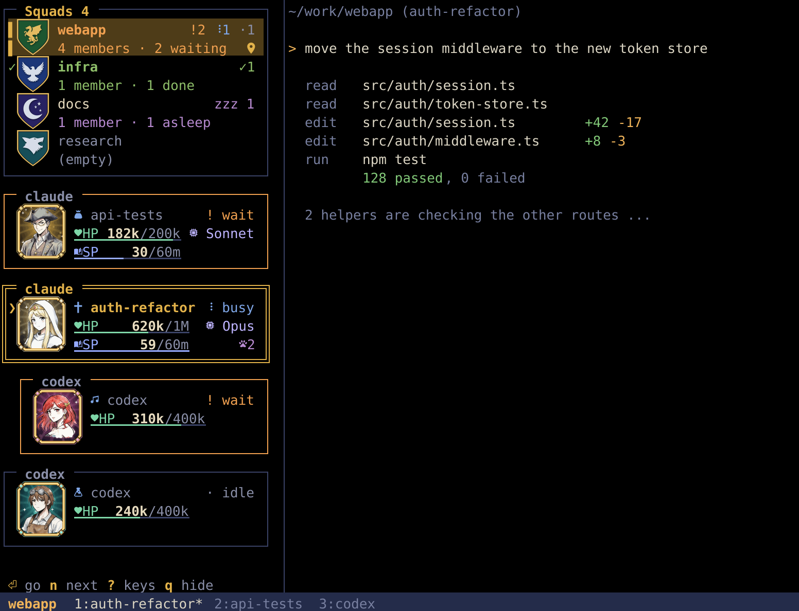
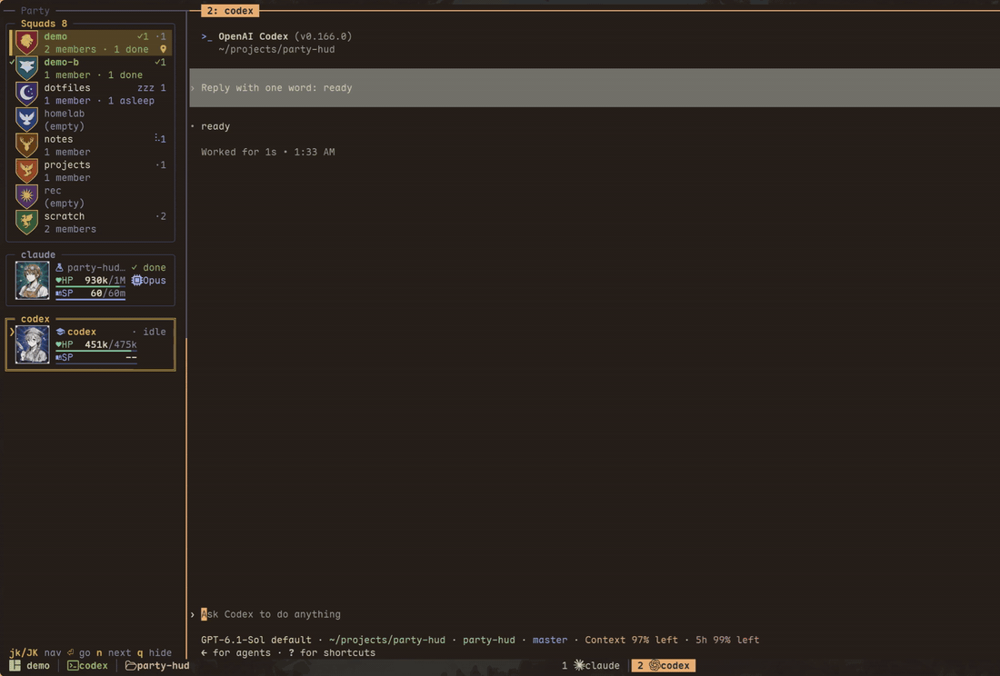
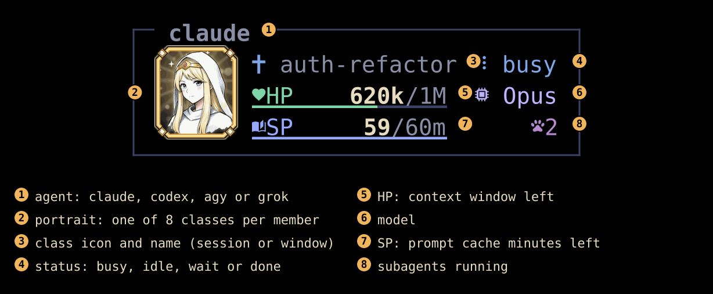
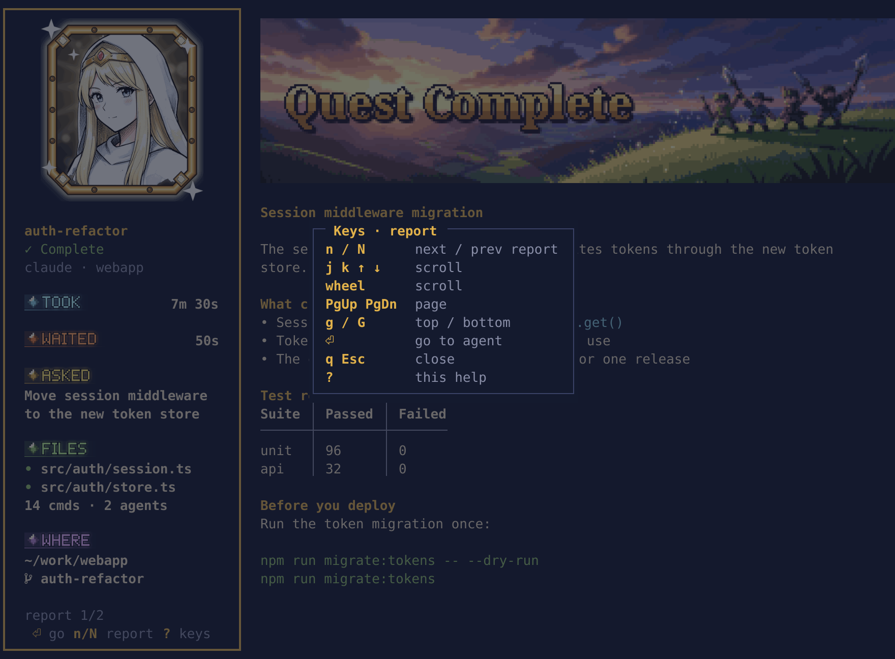
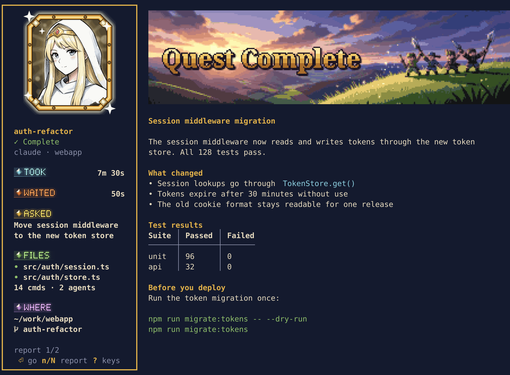
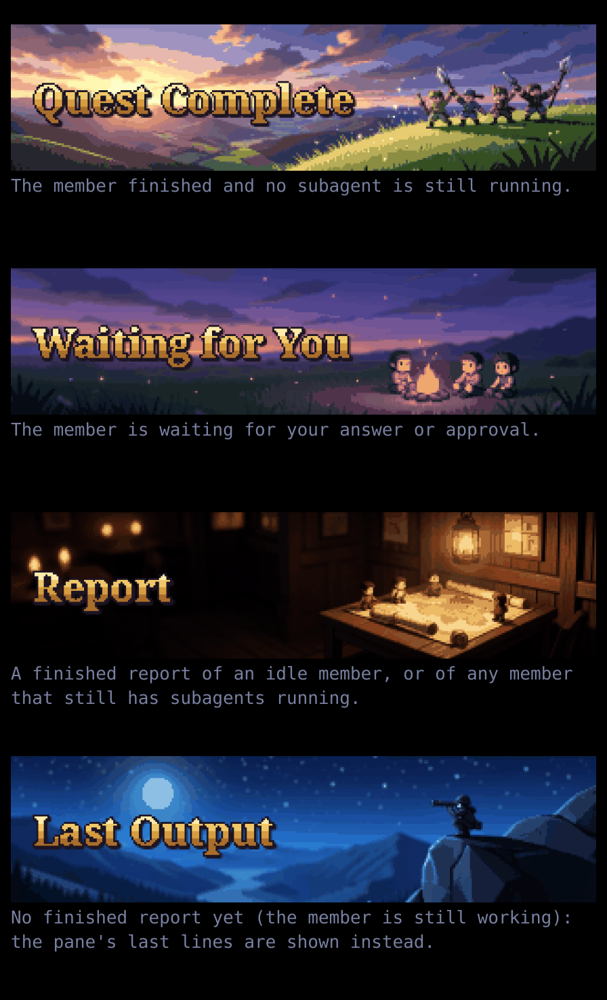
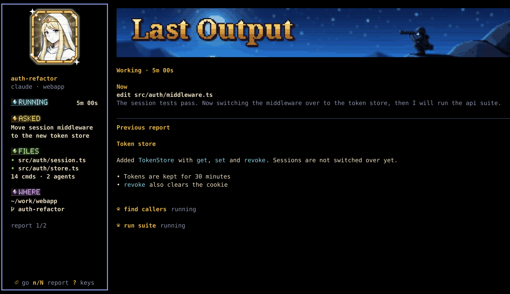

# party-hud

[繁體中文](README.zh-TW.md)

A tmux plugin that shows your coding agents as an RPG party, in a sidebar.
Each tmux session is a **squad**, each agent running in it (Claude Code, Codex, agy, Grok) is a **member**
with a portrait, a status, **HP** (context left) and **SP** (prompt cache minutes left).



- **See who needs you.** Squads light up orange when someone is waiting for you, green when someone finished and
  you have not looked yet, purple (`zzz 1`) when a member's prompt cache has expired. A gray `·1` counts idle members.
  A bell rings in windows you are not looking at.
- **Jump there.** `n` goes to the next member that is waiting (then finished). `Enter` switches to the member's pane.
- **Know when to compact.** HP is the context window left (`620k/1M`), blinking under 10%.
  SP counts down the prompt cache (`59/60m`); after it hits 0 the next message re-reads the whole context.
  A member with no cache data shows no SP row. In a narrow sidebar the name is cut first and HP keeps its full value.
  Runs of empty squads fold into one `+N empty` row (the squad under the cursor always shows).
  With many squads the Squads frame shrinks around the viewed squad and shows `▲ n more` / `▼ n more`, so the selected card always stays on screen.
- **See it change.** A card's frame blinks slowly for about 4 s when its member turns done or waiting (that squad's name in the Squads list blinks with it, so you see it from another squad too), and a big change shows next to the number for about 10 s: HP in percentage points (`+40%`), SP in minutes (`-12`), 5 or more. `set -g @party_anim off` turns both off.
- **Cheap.** One process collects data for all sidebars at most every 2 seconds; the others only read the shared snapshot.
  Each sidebar wakes once per second and redraws only when the frame changed. Only sidebars you can see keep a
  process (about 25 MB each); hidden ones stop and restart when you switch to their window.
  Python standard library only, no daemon, no network. See [performance](docs/performance.md).

A Claude Code member stops to ask a question in another window: its squad turns orange, `n` selects it and `Enter`
jumps there.



## Reading a card



Every member gets one of 8 classes (portrait and icon), picked from its session id; members of one squad do not repeat.
The name (3) is the Claude Code session name (`/rename` or its automatic title), else the tmux window name;
other agents show their kind (`codex`, `agy`, `grok`).
Above the cards, each tmux session is a squad with its own crest. The squad you are looking at has a gold background
and bar, and a pin marks the session the sidebar itself is in.

## Requirements

- Linux or macOS on the machine running tmux. Works over SSH: the remote runs everything, your local terminal only draws.
- tmux 3.3 or newer, Python 3.10 or newer (on macOS the system `python3` is 3.9; use Homebrew's).
- A [Nerd Font](https://www.nerdfonts.com/) in your terminal.
- For portraits and crests: [Ghostty](https://ghostty.org/) or [Kitty](https://sw.kovidgoyal.net/kitty/)
  (Kitty graphics protocol with Unicode placeholders). Other terminals get the text version automatically.

## Install

With [TPM](https://github.com/tmux-plugins/tpm):

```tmux
set -g @plugin 'mangow314/party-hud'
```

Or clone it anywhere and add `run-shell ~/path/to/party-hud/party.tmux` to `~/.tmux.conf`.

### HP for Claude Code (recommended)

Claude Code passes a JSON object to your statusline command. Forward it to party-hud so HP shows the real
context size and the model name. In your statusline script (`statusLine.command` in `~/.claude/settings.json`):

```bash
input=$(cat)
printf '%s' "$input" | ~/.tmux/plugins/party-hud/integrations/claude-statusline.sh
# ... the rest of your statusline, using "$input" ...
```

Without it, HP is estimated from the transcript. Details: [docs/integrations.md](docs/integrations.md).

### Terminal settings for the HP / SP bars

The bars are colored underlines. In Ghostty they look best a little lower and thicker:

```
adjust-underline-position = 2
adjust-underline-thickness = 3
```

If you connect over SSH, the remote needs your terminal's terminfo (Ghostty: `shell-integration-features = ssh-terminfo`).

## Keys

| Key | Action |
|---|---|
| `prefix C-t` | Open / close the sidebar in every window |
| `prefix P` | Popup version |
| `prefix a` | Jump to the next member that is waiting or done, without opening anything |
| `prefix R` | Quest report: members waiting or done first, else the current window's member; `n` cycles through all members |
| `j` / `k` | Next / previous member in this squad (stops at the ends) |
| `J` / `K` | Next / previous squad |
| `1`–`9` | Member N of this squad |
| `Enter` | Go to that member's pane |
| `n` | Next waiting member, then next finished one |
| `v` | Peek at the member's last lines of output |
| `r` | In the sidebar: open the selected member's quest report in a pane |
| `Esc` / `q` | Back to your pane / hide all sidebars |
| `?` | Show / hide the key help (also in the quest report); while it is open `Esc` / `q` only close the help |



Drag the sidebar border to resize; the width is remembered for all sidebars (minimum 30 columns).

### Quest reports



`prefix R` opens a pane with the last report of a member that finished or is waiting for you; if none is, it shows the member in the current window (an idle one its last report, a working one its in-progress page), and `n` cycles through all members. On Ghostty and
Kitty the page opens with a pixel-art banner (at most 10 rows tall, up to 80 columns wide in a narrow pane) with the title drawn inside the picture, and the member's
portrait below it; elsewhere the title is a text line. Then come how long it took (from your prompt to its answer), HP left,
then the report itself with its Markdown styled (tables become aligned columns, or one "name: value" group per row when too wide). On tmux 3.8+ the pane floats over the window; on older tmux it splits the
current window in half.

- In a pane 100 columns or wider (with images) the page splits: a thick-framed column on the left holds the large portrait
  (gold-framed, about as tall as the banner, centered, top aligned with the banner), name, a status tag (`✓ Complete` or `! Waiting`), `kind · squad`, `TOOK` and `WAITED` (label left, value right; a waiting member's `WAITED` row gets an orange band and a `!`), `ASKED` (what you typed this turn, cut to 3 rows; pasted text shows only when you typed nothing else; a slash command shows as `/name args`; notifications and other system messages are skipped), `FILES` (a `•` before each file; files edited this turn, relative to the pane's directory, long paths cut from the left, at most 6 rows then `+N more`; then `14 cmds · 3 agents`, zero counts left out; files a subagent edited are not counted), `WHERE` (full path, home written as `~`, and git branch), and its frame runs down to the bottom-left corner of the pane, with the key hints on its last row. The headings are small pixel-art labels (gem, glow, one color each: `TOOK` cyan, `WAITED` orange, `ASKED` gold, `FILES` and `WORK` green, `WHERE` violet; bold colored text where images are off), and the frame color follows the state: gold when done, orange when waiting, blue for a report, blue-violet while working. The banner
  (at most 10 rows, as wide as the right column; on a very wide pane it stops at 8:1 and leaves the rest empty) and the report fill the right. Report text wraps at the banner's width; code blocks and the `Last output` lines are not narrowed.
- Each new page (the first one, and every `n` / `N`) opens with a short animation of about 0.4 s: the banner and the left column appear at once, the report text follows in a few steps. Any key or mouse input skips it and is handled as usual. `set -g @party_anim off` turns it off.
- For Claude Code the report is the text after the last tool call of its last answer; for Codex, its last finished reply.
- Without a report the pane's last lines are shown instead (`Last output`): always for agy and Grok, and usually for a
  Claude member waiting for a permission or an answer, whose question is in those lines. The lines keep the pane's own colours. A member waiting for you always gets the `Waiting` banner (also with a report or running subagents); others without a report get `Last output`.
- The banner follows the member: `Quest Complete` (done, nothing still running), `Waiting for You` (waiting for your answer), `Report` (a finished report of an idle member, or of any member with running subagents), `Last Output` (no finished report yet).

  

- A Claude Code or Codex member that is still working shows an in-progress page: a status row (`Working · 12m 03s`, the time since its last typed prompt), a `Now` block (its newest tool call and the last lines of its newest text), then the previous round's report (headed `Previous report`). The page re-reads about every 1.5 s while it is open and switches to the real report once the member is done or waiting. The left column shows this round's `ASKED`, `FILES` and `WHERE`; a `RUNNING` label with the time so far takes the place of `TOOK`.

  

- In the split page the left column stays put and only the right column (banner and text) scrolls; in a narrow pane the whole page scrolls. Scroll with `j`/`k`, the arrow keys or the mouse wheel (a line), `PgUp`/`PgDn` (a page), `g`/`G` (top/bottom). A report that fits does not move. To copy text, hold `Shift` and drag (the terminal does the selection).
- Resizing the pane redraws the report at the new size right away and as often as it can be drawn, in place and without clearing the screen; the images follow once the resize has stopped for a moment.
- If you split the floating report pane, it stays smaller after the new pane closes; press `q` and `prefix R` to reopen it.
- `n` next report, `N` previous report, `Enter` goes to the member's pane, `q` / `Esc` closes the pane, `?` shows every key (press `?` / `Esc` / `q` to go back to the same spot).
- Reading a report does not clear the "done" mark; going to the pane does.
- A Claude Code member that is still running subagents also gets a report page. The title changes from
  `Quest complete` to `N subagents still running` (N = running subagents; `1 subagent still running` for one), and each running subagent is listed under the
  report with its name and `running`.
- Subagents that finished during that answer's turn (since your last prompt) are listed under the report too, each
  with the last report it handed back (Markdown styled).

To see the count in your status line, the collector writes the number of members waiting or done to the tmux
variable `@party_reports`:

```tmux
set -ag status-right '#{?#{@party_reports}, reports #{@party_reports},}'
```

### Reading a report from a script

```sh
python3 ~/.tmux/plugins/party-hud/party.py --report-text PANE [--wait] [--timeout SEC]
```

`PANE` is a tmux pane id such as `%12`. Without `--wait` it prints the member's current report at once. With `--wait`,
if the member is working, still has subagents running, or has a finished subagent the main conversation has not answered
yet, it waits until that stops and then prints. `--timeout` is the most seconds to wait (default 600).

| Exit code | Meaning |
|---|---|
| 0 | Report printed. A known agent with no report also exits 0: stdout is empty and stderr says `no report for PANE` |
| 2 | Bad arguments (not a pane id, bad timeout) or the pane does not exist |
| 3 | `--timeout` ran out while waiting |
| 4 | The pane exists but is not a known agent |

### Crew commands

`--summon AGENT` opens a pane running `claude`, `codex`, `agy` or `grok` and prints its pane id once it takes input.
`--ask PANE TEXT` pastes text into an agent's pane, presses Enter, and prints the time it was sent. Together with `--report-text PANE
--wait --after EPOCH` (above), one agent can hand work to another and wait for the answer:

```sh
m=$(python3 ~/.tmux/plugins/party-hud/party.py --summon agy)
t=$(python3 ~/.tmux/plugins/party-hud/party.py --ask "$m" "your question")
python3 ~/.tmux/plugins/party-hud/party.py --report-text "$m" --wait --after "$t"
```

`--summon` exits 0 ready, 2 bad arguments or tmux failure, 3 timeout (`--cwd DIR`, `--window`, `--timeout SEC`). `--summon codex --read-only` starts codex in its enforced read-only sandbox (`-s read-only`); the other agents have no such mode and exit 2. `--ask` exits
0 sent, 2 bad or missing pane, 4 not an agent. The sidebar still only reads; these commands open panes or send keys only
when called.

Every round is saved for later reference under `~/.local/state/party-hud/crew/` (`$XDG_STATE_HOME/party-hud/crew/` when `XDG_STATE_HOME` is set), one directory `<start time UTC>-<pane id>/round-NNN/`
(`question.md`, `reply.md`, `meta.json`). `--summon` removes sessions untouched for 14 days. If saving fails, `--ask`,
`--report-text` and `--summon` exit 5 after doing their job and say why on stderr.

### Claude Code skill (party-crew)

`skills/party-crew/SKILL.md` is a short Claude Code skill that tells Claude when and how to use `--summon`, `--ask` and `--report-text`. With it, you can tell Claude "ask codex for a second opinion on this diff" and it opens the pane, sends the question and reads the answer back. Claude loads it when the task fits, or you can call it with `/party-crew`.

Link it once (TPM install path; with a clone, use your checkout path):

```sh
mkdir -p ~/.claude/skills
ln -s ~/.tmux/plugins/party-hud/skills/party-crew ~/.claude/skills/party-crew
```

With Claude Code's Bash sandbox on, these commands cannot reach the tmux socket (`Error connecting to /tmp/tmux-1000/default (Operation not permitted)`). To let them run, add party.py to `sandbox.excludedCommands` in `~/.claude/settings.json`:

```json
"excludedCommands": ["python3 ~/.tmux/plugins/party-hud/party.py *"]
```

- Matching commands run outside the sandbox, with no file or network limits, so add only this one.
- The match is on the command text, and every part of the line has to match: a line with `$(...)`, a redirect or `cd` stays in the sandbox. So Claude has to run each step as its own call and read the pane id and time from the output, not use the `m=$(...)` form above.
- `sandbox.network.allowAllUnixSockets` also works, but it opens every Unix socket; not recommended.

## Options

Set these in `~/.tmux.conf` before the plugin loads.

| Option | Default | Meaning |
|---|---|---|
| `@party_key_toggle` | `C-t` | Key for open / close |
| `@party_key_popup` | `P` | Key for the popup |
| `@party_key_next` | `a` | Key for "next waiting" |
| `@party_key_report` | `R` | Key for quest reports |
| `@party_art` | `auto` | `on` / `off` forces images; `auto` uses them on Ghostty and Kitty |
| `@party_anim` | `on` | `off` turns off the opening animation of the report pane and the sidebar's card blink and HP / SP `+N` / `-N` labels |
| `@party_sidebar_width` | `34` | Sidebar width in columns |

Images leave tmux through `allow-passthrough`, which party-hud turns on for its own sidebar panes only: a program in any
other pane still cannot send escape sequences straight to your terminal. The `prefix P` popup is not a pane, so it shows images only if
you set `allow-passthrough on` globally in `~/.tmux.conf` yourself (then every pane can bypass tmux); otherwise it uses
the text version.

## How members are detected

| Agent | Status | HP | SP |
|---|---|---|---|
| Claude Code | `~/.claude/sessions/*.json` (busy / idle) | statusline integration, or estimated from the transcript | prompt cache TTL from the transcript |
| Codex | screen changes | rollout file in `~/.codex/sessions` | not shown |
| agy, Grok | screen changes | `--` | not shown |

A pane counts when its command is one of these agents, or when an agent runs among its child processes (for example
under `node` or a wrapper script).
Claude Code members show waiting when Claude Code itself reports it is waiting for you (no extra setup).
If you use [workmux](https://github.com/raine/workmux), its waiting / done pane status is used too.
Everything is read locally; nothing is sent anywhere. More: [docs/architecture.md](docs/architecture.md).

## Limitations

- One tmux server per user. All servers share one state folder and tmux pane ids (`%5`) repeat across servers,
  so with a second server (`tmux -L name`) the sidebars can show the wrong members or jump to the wrong pane.
  Separate sessions in one server work fine.

## Credits and license

Code: [MIT](LICENSE). Images: [CC0](art/LICENSE), generated locally with FLUX.2 [klein] 4B (Apache-2.0);
prompts, seeds and the full pipeline are in [ASSETS.md](ASSETS.md).
