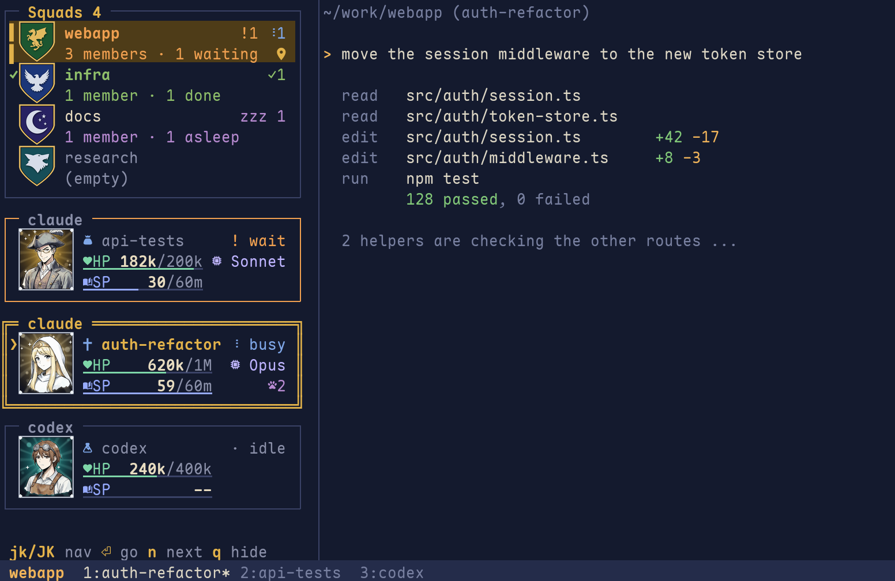
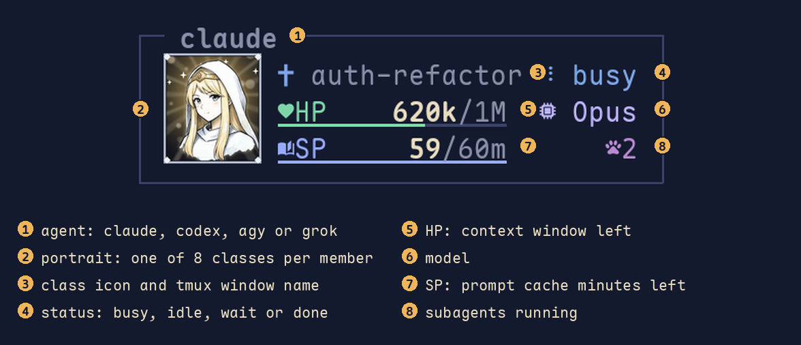

# party-hud

[繁體中文](README.zh-TW.md)

A tmux plugin that shows your coding agents as an RPG party, in a sidebar.
Each tmux session is a **squad**, each agent running in it (Claude Code, Codex, agy, Grok) is a **member**
with a portrait, a status, **HP** (context left) and **SP** (prompt cache minutes left).



- **See who needs you.** Squads light up orange when someone is waiting for you, green when someone finished and
  you have not looked yet, purple (`zzz 1`) when a member's prompt cache has expired. A gray `·1` counts idle members.
  A bell rings in windows you are not looking at.
- **Jump there.** `n` goes to the next member that is waiting (then finished). `Enter` switches to the member's pane.
- **Know when to compact.** HP is the context window left (`620k/1M`), blinking under 10%.
  SP counts down the prompt cache (`59/60m`); after it hits 0 the next message re-reads the whole context.
- **Cheap.** One process collects data for all sidebars at most every 2 seconds; the others only read the shared snapshot.
  Each sidebar wakes once per second and redraws only when the frame changed. Only sidebars you can see keep a
  process (about 25 MB each); hidden ones stop and restart when you switch to their window.
  Python standard library only, no daemon, no network. See [performance](docs/performance.md).

## Reading a card



Every member gets one of 8 classes (portrait and icon), picked from its session id; members of one squad do not repeat.
The name (3) is the Claude Code session name (`/rename` or its automatic title), else the tmux window name;
other agents show their kind (`codex`, `agy`, `grok`).
Above the cards, each tmux session is a squad with its own crest. The squad you are looking at has a gold background
and bar, and a pin marks the session the sidebar itself is in.

## Requirements

- Linux or macOS on the machine running tmux. Works over SSH: the remote runs everything, your local terminal only draws.
- tmux 3.3 or newer, Python 3.10 or newer (on macOS the system `python3` is 3.9; use Homebrew's).
- A [Nerd Font](https://www.nerdfonts.com/) in your terminal.
- For portraits and crests: [Ghostty](https://ghostty.org/) or [Kitty](https://sw.kovidgoyal.net/kitty/)
  (Kitty graphics protocol with Unicode placeholders). Other terminals get the text version automatically.

## Install

With [TPM](https://github.com/tmux-plugins/tpm):

```tmux
set -g @plugin 'mangow314/party-hud'
```

Or clone it anywhere and add `run-shell ~/path/to/party-hud/party.tmux` to `~/.tmux.conf`.

### HP for Claude Code (recommended)

Claude Code passes a JSON object to your statusline command. Forward it to party-hud so HP shows the real
context size and the model name. In your statusline script (`statusLine.command` in `~/.claude/settings.json`):

```bash
input=$(cat)
printf '%s' "$input" | ~/.tmux/plugins/party-hud/integrations/claude-statusline.sh
# ... the rest of your statusline, using "$input" ...
```

Without it, HP is estimated from the transcript. Details: [docs/integrations.md](docs/integrations.md).

### Terminal settings for the HP / SP bars

The bars are colored underlines. In Ghostty they look best a little lower and thicker:

```
adjust-underline-position = 2
adjust-underline-thickness = 3
```

If you connect over SSH, the remote needs your terminal's terminfo (Ghostty: `shell-integration-features = ssh-terminfo`).

## Keys

| Key | Action |
|---|---|
| `prefix C-t` | Open / close the sidebar in every window |
| `prefix P` | Popup version |
| `prefix a` | Jump to the next member that is waiting or done, without opening anything |
| `j` / `k` | Next / previous member in this squad (stops at the ends) |
| `J` / `K` | Next / previous squad |
| `1`–`9` | Member N of this squad |
| `Enter` | Go to that member's pane |
| `n` | Next waiting member, then next finished one |
| `v` | Peek at the member's last lines of output |
| `Esc` / `q` | Back to your pane / hide all sidebars |

Drag the sidebar border to resize; the width is remembered for all sidebars (minimum 30 columns).

## Options

Set these in `~/.tmux.conf` before the plugin loads.

| Option | Default | Meaning |
|---|---|---|
| `@party_key_toggle` | `C-t` | Key for open / close |
| `@party_key_popup` | `P` | Key for the popup |
| `@party_key_next` | `a` | Key for "next waiting" |
| `@party_art` | `auto` | `on` / `off` forces images; `auto` uses them on Ghostty and Kitty. `off` also leaves `allow-passthrough` alone |
| `@party_sidebar_width` | `34` | Sidebar width in columns |

## How members are detected

| Agent | Status | HP | SP |
|---|---|---|---|
| Claude Code | `~/.claude/sessions/*.json` (busy / idle) | statusline integration, or estimated from the transcript | prompt cache TTL from the transcript |
| Codex | screen changes | rollout file in `~/.codex/sessions` | not available (`--`) |
| agy, Grok | screen changes | `--` | `--` |

A pane counts when its command is one of these agents, or when an agent runs among its child processes (for example
under `node` or a wrapper script).
If you use [workmux](https://github.com/raine/workmux), its waiting / done pane status is used too.
Everything is read locally; nothing is sent anywhere. More: [docs/architecture.md](docs/architecture.md).

## Limitations

- One tmux server per user. All servers share one state folder and tmux pane ids (`%5`) repeat across servers,
  so with a second server (`tmux -L name`) the sidebars can show the wrong members or jump to the wrong pane.
  Separate sessions in one server work fine.

## Credits and license

Code: [MIT](LICENSE). Images: [CC0](art/LICENSE), generated locally with FLUX.2 [klein] 4B (Apache-2.0);
prompts, seeds and the full pipeline are in [ASSETS.md](ASSETS.md).
