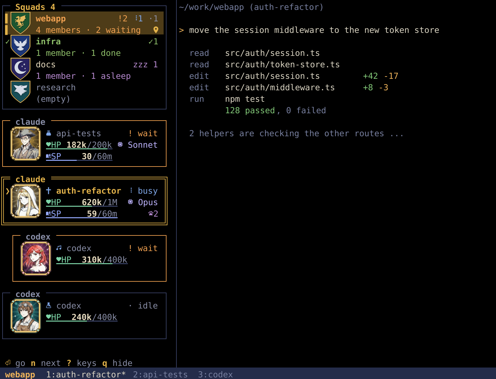
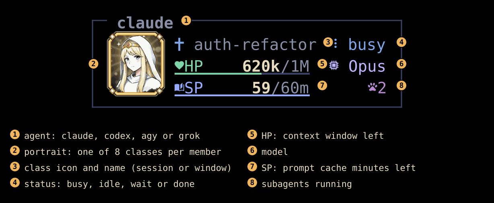
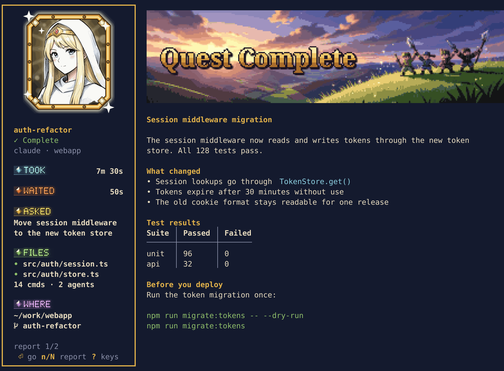

# party-hud

[English](README.md)

party-hud 是 tmux 外掛：把同時在跑的 coding agent 畫成一隊 RPG 隊員，讓你一眼看出誰在等你、誰做完了、context 還剩多少，
並能直接跳過去或讀它的報告。只讀、純本機、佔用很低。

每個 tmux session 是一個**小隊**，裡面跑的 agent（Claude Code、Codex、agy、Grok）是**隊員**：
有頭像、狀態、**HP**（剩餘 context）和 **SP**（prompt cache 還剩幾分鐘）。



- **一眼看出誰在等你**：有隊員等你回應，小隊變橘色；有隊員做完，小隊變綠色。
  `n` 選到下一個等你的隊員，`Enter` 切到它的 pane。
- **知道什麼時候該 compact**：HP 和 SP 顯示每個隊員剩下的 context 和快取時間。
- **看它做了什麼**：`prefix R` 開選隊畫面，每位隊員都有預覽；選一位就打開它最後交出的報告，Markdown 會上色。
  這部分和側欄一樣只讀。
- **選用：agent 找 agent 幫忙**：附加功能。一個 agent 可以開另一個 agent、送出問題，再讀回答案。
- **省資源、只在本機**：只用 Python 標準函式庫，沒有常駐服務，不連網，不會寫入 agent 的檔案。
  實測數字見[佔用](#佔用)。

用 TPM 安裝（`set -g @plugin 'mangow314/party-hud'`），再按 `prefix C-t`。細節見[安裝](#安裝)。

## 一眼看出誰在等你

另一個 window 的 Claude Code 停下來問你問題：它的小隊變成橘色，按 `n` 選到它，再按 `Enter` 跳過去。

橘色是在等你，綠色是做完但你還沒看，紫色 `zzz 1` 是有人的快取過期，灰色 `·1` 是閒置的隊員數。
你沒在看的 window 會響鈴。更多細節見 [docs/sidebar.md](docs/sidebar.md)。

從側欄到報告再回來的完整流程：



## 怎麼看隊員卡



| 編號 | 意思 |
|---|---|
| 1 | agent 種類：claude、codex、agy 或 grok |
| 2 | 頭像：8 種職業之一，依 session id 分配，同一小隊 8 人以內不重複 |
| 3 | 職業圖示和名稱：Claude Code 的 session 名稱（`/rename` 或自動標題），沒有才用 tmux window 名稱；其他 agent 顯示種類 |
| 4 | 狀態：busy（工作中）、idle（閒置）、wait（等你）、done（做完） |
| 5 | HP：剩餘的 context（`620k/1M`），剩不到 10% 會閃爍 |
| 6 | 模型 |
| 7 | SP：prompt cache 還剩幾分鐘（`59/60m`）；歸零後，下一句話會重新讀入整段 context |
| 8 | 正在跑的子代理數量 |

隊員變成做完或等你時，卡片框線會閃爍；HP 或 SP 大幅變化時，數字旁會短暫顯示變化量。

## 任務回報：看它做了什麼

`prefix R` 會在目前的 window 上開一個 pane 顯示選隊畫面（tmux 3.8 以上是浮動 pane，舊版 tmux 則分割視窗）。
名單列出所有小隊的 lead，依序是等你的、做完的、工作中、閒置、休眠。每位 lead 就是側欄上那張隊員卡。
被召喚的隊員（crew）只在等輸入時列出，是它的 lead 卡片底下縮排的一行。

名單旁邊顯示游標那位的資訊：時間與目錄、它的 lead 底下各 crew 的狀態、你問的話，以及報告預覽。
工作中的成員預覽的是它正在做的事，而且會跟著更新。還沒有完成報告的成員顯示 pane 最後幾行。看預覽不算已讀。

`j`／`k` 或方向鍵移動，`1`–`9`、`Enter`、`l` 開報告，`q`／`Esc` 關閉，`?` 看全部按鍵。
要去某位的 pane：先開它的報告，在報告頁再按 `Enter`。


報告頁開在同一個 pane 裡。pane 夠寬時，左欄顯示花了多久、等了你多久、你問了什麼、改了哪些檔、在哪個目錄；
右邊是報告本文，Markdown 會上色。



還在工作的隊員則顯示它現在正在做什麼：


報告頁裡按 `n` 換到下一位（先是等你的，再來是做完的）；如果是從選隊畫面進來的，按 `h` 回選隊畫面。
橫幅種類、pane 大小、版面、捲動、圖片和全部按鍵見 [docs/reports.md](docs/reports.md)（英文）。

## 選用：協作，agent 找 agent 幫忙

這是附加功能，不用它，側欄和報告畫面也照常運作。HUD 本身（側欄、選隊畫面、報告頁）只讀：不會寫入 agent 的檔案，也不連網。
下面這些子指令只在 agent 呼叫時，才會開 pane、送按鍵，以及關掉自己開的 pane。

一個 agent 可以開另一個 agent、送出問題，再等它回覆。每一步都會印出下一步要用的值（先是 `%12` 這類 pane id，再來是送出的時間）：

```sh
python3 ~/.tmux/plugins/party-hud/party.py --summon codex --read-only
python3 ~/.tmux/plugins/party-hud/party.py --ask PANE '你的問題'
python3 ~/.tmux/plugins/party-hud/party.py --report-text PANE --wait --after TIME
python3 ~/.tmux/plugins/party-hud/party.py --dismiss PANE
```

`--summon` 預設把隊員開在背景的 tmux session `crew-<你的 pane 數字>`（不開側欄）；`--window` 改開在你的 session 的新 window，`--here` 改成在你旁邊分割。
側欄把 crew 列在召喚它的隊員底下。crew 做完不會響鈴、不點亮小隊、也不算未讀；等輸入時照常提醒。
`--read-only` 讓 codex 用沙箱唯讀；claude、grok、agy 用自己的 plan 模式，由 agent 自己擋改檔。agy 在 plan 模式跑 shell 指令仍會問權限，這時 HUD 顯示它是 waiting。
`--report-text` 在隊員等輸入時回退出碼 7。`--dismiss` 關掉你召喚的隊員，條件是它沒在工作也沒在等輸入，而且你已讀過它的報告。
被召喚的隊員不能再召喚：需要協助時回報給召喚它的 lead，由 lead 找人。

路徑是 TPM 的安裝位置；用 clone 的話換成你的 checkout 路徑。裝好內附的 `party-crew` skill 後，可以直接跟 Claude Code 說「找 codex 給這個 diff 第二意見」。
退出碼、問答紀錄、skill 安裝和沙箱設定見 [docs/crew.md](docs/crew.md)（英文）。

## 佔用

以下數字都在同一台機器上量測（AMD Ryzen 9 5900XT、Linux、Python 3.14）；完整表格和在你的機器上怎麼量，見
[docs/performance.md](docs/performance.md)（英文）。

- 實際使用時的側欄：全部側欄行程合計平均佔一顆核心的 0.22 %、記憶體平均 32.4 MB；條件是 24 個 window（24 個側欄 pane）、
  4 位 agent、正常切換 window，量 300 秒（`bench/live.sh`）。看不到的側欄 2 秒後就結束行程，所以只有你在看的 window 會跑。
- 用假資料畫一格側欄：5 位 agent 時收集 0.056 ms、繪製 0.294 ms（`bench/bench.py`，200 次的中位數）。
- 選隊畫面與報告頁：在 179 × 47 的 pty 裡、5 位 lead、開圖片，跑 27.5 秒的固定按鍵腳本，佔一顆核心的 0.84 %
  （`bench/use.py`，3 次的中位數）。

## 需求

- 跑 tmux 的機器要是 Linux 或 macOS。
- tmux 3.3 以上。
- tmux 的 `PATH` 上的 `python3` 要是 3.10 以上。macOS 內建的是 3.9：請裝 Homebrew 的版本，並確認 tmux 先找到它，否則按鍵沒有反應。
- 終端機要用 [Nerd Font](https://www.nerdfonts.com/)。
- 頭像和隊徽要用 [Ghostty](https://ghostty.org/) 或 [Kitty](https://sw.kovidgoyal.net/kitty/)，因為要支援 Kitty 圖片協定的 Unicode 佔位字元。其他終端機會自動改用文字版。
- 選用：`jq`，給下面的 Claude Code HP 整合用。沒有 jq 時整合不會動作，HP 維持推估值。

## 安裝

用 [TPM](https://github.com/tmux-plugins/tpm)（tmux 外掛管理器）：在 `~/.tmux.conf` 加這行，再按 `prefix I` 安裝。

```tmux
set -g @plugin 'mangow314/party-hud'
```

或者 clone 到任何地方，在 `~/.tmux.conf` 加一行 `run-shell ~/path/to/party-hud/party.tmux`，再重新載入設定（`tmux source ~/.tmux.conf`）。

裝好後，在 tmux pane 裡啟動一個 agent，按 `prefix C-t` 打開側欄。

下面的路徑以 TPM 預設的 `~/.tmux/plugins/party-hud` 為例；用 clone 或其他 TPM 路徑的話，換成你的路徑。

### Claude Code 的 HP（建議設定）

Claude Code 每次更新 statusline 都會傳入一段 JSON。把這段 JSON 也轉給 party-hud，HP 就會顯示真正的 context 上限和模型名稱。加在你的 statusline 腳本裡，也就是 `~/.claude/settings.json` 的 `statusLine.command` 指向的那支：

```bash
input=$(cat)
printf '%s' "$input" | ~/.tmux/plugins/party-hud/integrations/claude-statusline.sh
# …你原本的 statusline，改用 "$input"…
```

這需要 `jq`。沒有設定的話，HP 會從 transcript 推估。細節見 [docs/integrations.md](docs/integrations.md)。

### 終端機小提示

- HP／SP 血條是彩色底線。在 Ghostty 把底線往下移一點、加粗一點比較好看：

  ```
  adjust-underline-position = 2
  adjust-underline-thickness = 3
  ```

- 透過 SSH 也能用：全部都在遠端跑，本機的終端機只負責畫面。遠端要有你終端機的 terminfo（記錄終端機支援哪些功能的檔案），Ghostty 可以設定 `shell-integration-features = ssh-terminfo` 自動處理。

## 按鍵

| 按鍵 | 動作 |
|---|---|
| `prefix C-t` | 在所有 window 開／關側欄 |
| `prefix a` | 不開任何東西，直接跳到下一個等你或做完的隊員 |
| `prefix R` | 任務回報：選隊畫面，跨小隊列出 lead（waiting、done、working、idle、sleep）並預覽，選一位開它的報告，報告頁按 `h` 回來 |
| `j`／`k` | 同一隊的下一位／上一位（到頭尾就停） |
| `J`／`K` | 下一隊／上一隊 |
| `1`–`9` | 這隊第 N 位 |
| `Enter` | 切到那位隊員的 pane |
| `n` | 下一個等你的，沒有的話下一個做完的 |
| `v` | 看那位隊員最後幾行輸出 |
| `r` | 在側欄裡：用 pane 開選中隊員的任務回報 |
| `Esc`／`q` | 回到原本的 pane／收起全部側欄 |
| `?` | 開／關按鍵說明（任務回報裡也能用）；說明開著時 `Esc`／`q` 只關說明 |

拖側欄邊框可以調寬度，所有側欄會一起記住新寬度，最窄 30 欄。

## 選項

設定在 `~/.tmux.conf`，要放在載入外掛之前。

| 選項 | 預設 | 意思 |
|---|---|---|
| `@party_key_toggle` | `C-t` | 開／關側欄的鍵 |
| `@party_key_next` | `a` | 「跳到下一個等你的」的鍵 |
| `@party_key_report` | `R` | 任務回報的鍵 |
| `@party_art` | `auto` | `on`／`off` 強制開／關圖片；`auto` 在 Ghostty、Kitty 自動開 |
| `@party_anim` | `on` | 設為 `off` 關閉報告頁的開場動畫，以及側欄的卡片閃爍和 HP／SP 的 `+N`／`-N` 標籤 |
| `@party_sidebar_width` | `34` | 側欄寬度（欄） |

## 怎麼認出隊員

| Agent | 狀態 | HP | SP |
|---|---|---|---|
| Claude Code | `~/.claude/sessions/*.json` | statusline 整合，或從 transcript 推估 | 從 transcript 讀快取 TTL |
| Codex | 畫面有沒有變化 | `~/.codex/sessions` 的 rollout 紀錄檔 | 不顯示 |
| agy、Grok | 畫面有沒有變化 | `--` | 不顯示 |

pane 的指令是上面這些 agent，或它的子行程裡有這些 agent，就算隊員。也會讀 [workmux](https://github.com/raine/workmux) 的狀態。
所有資料都只在本機讀取，不會送出去。細節見 [docs/integrations.md](docs/integrations.md)。

## 限制

- 每個使用者只支援一個 tmux server。所有 server 共用同一個狀態資料夾，而 pane 編號（`%5`）在不同 server 之間會重複，
  所以另開第二個 server（`tmux -L 名稱`）時，側欄可能顯示錯的隊員或跳錯 pane。同一個 server 裡開多個 session 沒有問題。

## 更多文件（英文）

- [docs/sidebar.md](docs/sidebar.md)：小隊顏色、HP／SP、閃爍、窄側欄、圖片
- [docs/reports.md](docs/reports.md)：任務回報頁的完整說明
- [docs/crew.md](docs/crew.md)：`--summon`、`--ask`、`--report-text`、`--dismiss` 和 party-crew skill
- [docs/integrations.md](docs/integrations.md)：每種 agent 讀了哪些資料
- [docs/architecture.md](docs/architecture.md)、[docs/performance.md](docs/performance.md)：設計與效能數據

## 致謝與授權

- 程式碼：[MIT](LICENSE)。
- 圖片：[CC0](art/LICENSE)，在本機用 FLUX.2 [klein] 4B（Apache-2.0）生成。提示詞、seed 和完整流程寫在 [ASSETS.md](ASSETS.md)。
