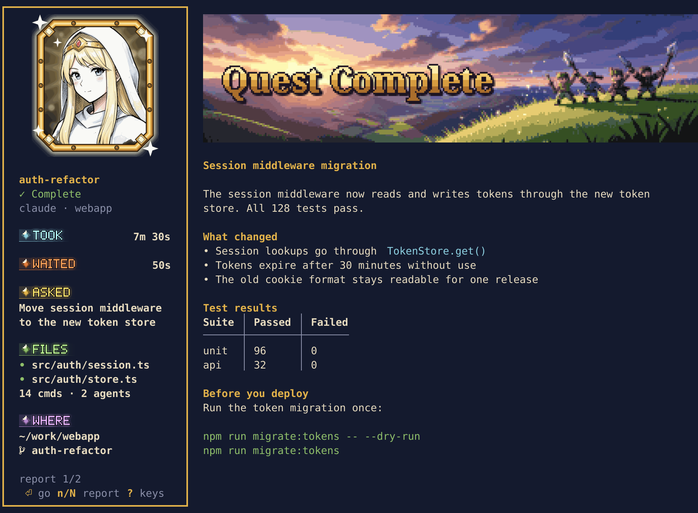
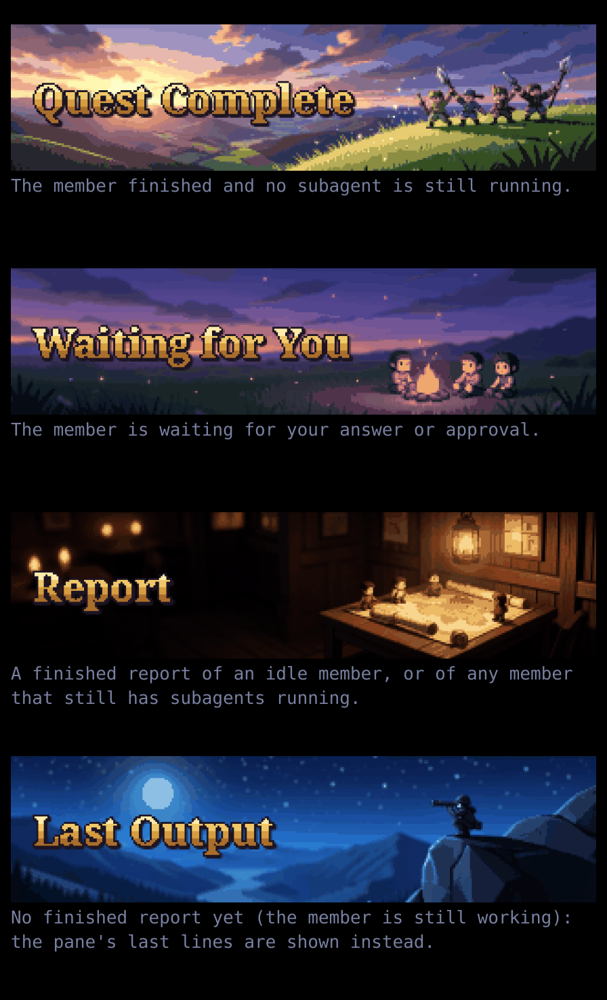
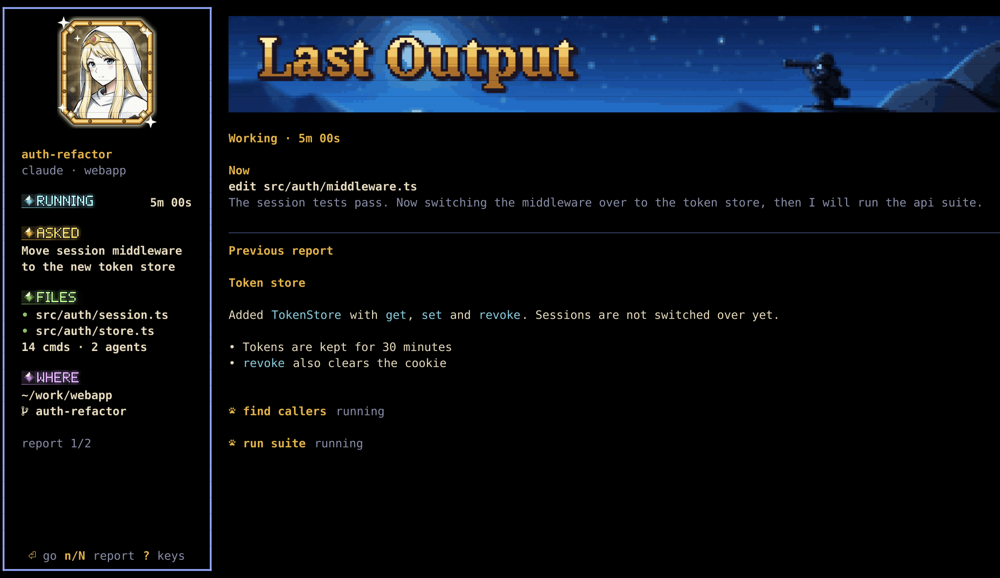
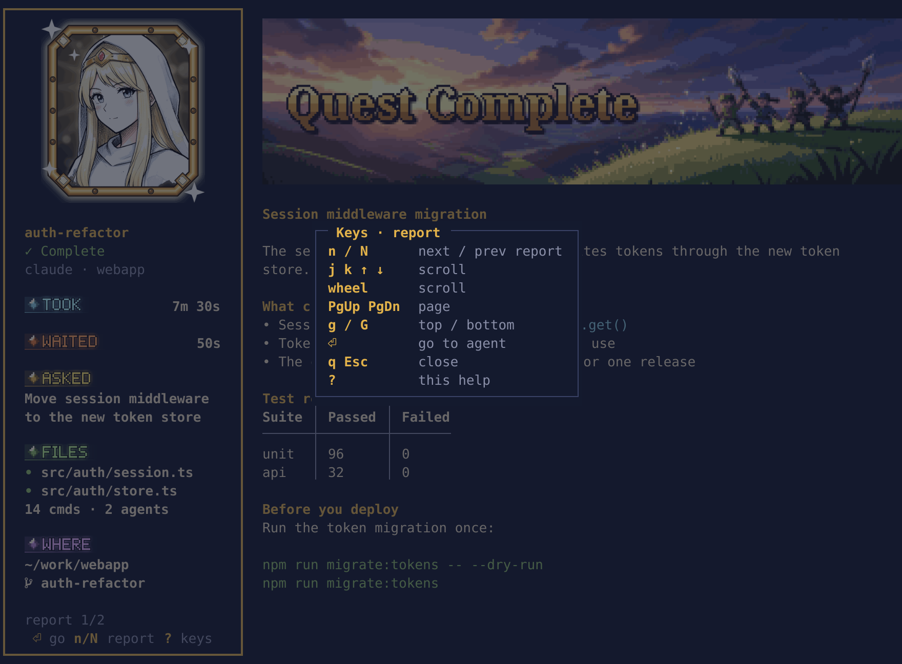

# Quest reports



`prefix R` opens the select screen in a pane (not a tmux menu). On tmux 3.8+ it is a floating pane centred in the window, 82 columns wide at a cell ratio of 0.5 (`select_cols`: the width follows the terminal's cell width / height, so the banner is the whole 4:1 image in any font; narrower in a narrower window); opening a report from it enlarges the pane to the report page's size (80% of the window high, 80% wide up to `report_cols` columns, 129 at a cell ratio of 0.5 and wider when the cells are narrower, centred, so the banner is the whole 8:1 image filling the right column, and still fills it when the drawable width is a column or two short) and `h` shrinks it back (the split used on older tmux has no such resizing). The screen: the list has one item per lead, across squads, in the order waiting, done, working, idle, sleep; a lead is the same member card as in the sidebar, with its number key on the left of the first row; a summoned member (crew) is listed only while it waits for input, as one indented row under its lead's card, in the waiting color with `waiting for you` at the right (the name is shortened first, the text dropped when the pane is too narrow); the first nine items have number keys. The member under the cursor is previewed beside the list: its `TOOK` / `WAITED` / `RUNNING` time and directory, the name and state of every crew of its lead, `ASKED` (at most 3 rows), then a title line with the report page's state word (`Quest complete`, `Waiting for you`, `Report`, `Working`, `Last output`) and `preview · not marked read`, then the report as this page draws it, cut to `… N more lines · ⏎ to read` when it does not fit. A working member shows its in-progress page, re-read about every 1.5 s (at the next redraw after that), and the screen redraws when something on it changes with time: on the whole second while a member works or has HP at 10% or less (spinner, blink), and when the rounded `RUNNING` / `WAITED` time of the member under the cursor turns, so they step once a second without drifting (from one hour on only the minutes show and they step once a minute); a redraw that leaves the screen as it was writes nothing; a member with no finished report shows the last lines of its pane, or `no report yet` when there is nothing to show. The list is 36 columns wide (3 for the number key, 33 for the card) and the preview takes the rest; a pane narrower than 79 columns draws only the list, and a pane too short for a card draws one row per member. Previewing does not mark a report as read. Pick one with `1`–`9`, `Enter` or `l` to open its last report in the same pane (a working member shows its in-progress page, an idle one its last report); `j`/`k` or the arrow keys move, `q` / `Esc` closes, `?` shows the keys. To go to a member's pane, open its report and press `Enter` there. With no members it shows `no party members` instead of a list. Its images follow the report page's rules (a text title where there are none) and, since it runs in a pane, it needs no global `allow-passthrough`. In the sidebar, `r` opens the selected member's report directly. `n` cycles through the members: waiting first, then done, then working with subagents running, then the rest (this window's first). A done member that has a lead is not in the waiting / done part of that order and does not count for the reminders below. On Ghostty and
Kitty the page opens with a pixel-art banner (at most 6 rows tall, which also sets its width, about 48 columns at a 1:2 cell, in a narrow pane) with the title drawn inside the picture, and the member's
portrait below it; elsewhere the title is a text line. Then come how long it took (from your prompt to its answer), HP left,
then the report itself with its Markdown styled (tables become aligned columns, or one "name: value" group per row when too wide). On tmux 3.8+ the pane floats over the window; on older tmux it splits the
current window in half.


## Layout

- In a pane 100 columns or wider (with images) the page splits: a thick-framed column on the left holds the large portrait
  (gold-framed, 14 columns wide, a little taller than the banner, centered, top aligned with the banner), name, a status tag (`✓ Complete` or `! Waiting`), `kind · squad`, `TOOK` and `WAITED` (label left, value right; a waiting member's `WAITED` row gets an orange band and a `!`), `ASKED` (what you typed this turn, cut to 3 rows; pasted text shows only when you typed nothing else; a slash command shows as `/name args`; notifications and other system messages are skipped), `FILES` (a `•` before each file; files edited this turn, relative to the pane's directory, long paths cut from the left, at most 6 rows then `+N more`; then `14 cmds · 3 agents`, zero counts left out; files a subagent edited are not counted), `WHERE` (full path, home written as `~`, and git branch), and its frame runs down to the bottom-left corner of the pane, with the key hints on its last row. The headings are small pixel-art labels (gem, glow, one color each: `TOOK` cyan, `WAITED` orange, `ASKED` gold, `FILES` and `WORK` green, `WHERE` violet; bold colored text where images are off), and the frame color follows the state: gold when done, orange when waiting, blue for a report, blue-violet while working. The banner
  (at most 6 rows, as wide as the right column; on a very wide pane it stops at 8:1 and leaves the rest empty) and the report fill the right. Report text wraps at the banner's width; code blocks and the `Last output` lines are not narrowed.
- Each new page (the first one, and every `n` / `N`) opens with a short animation of about 0.4 s: the banner and the left column appear at once, the report text follows in a few steps. Any key or mouse input skips it and is handled as usual. `set -g @party_anim off` turns it off.

## What the report is

- For Claude Code the report is the text after the last tool call of its last answer; for Codex, its last finished reply;
  for agy and Grok, which write no log, their last reply read off the screen.
- Without a report the pane's last lines are shown instead (`Last output`): usually for a
  Claude member waiting for a permission or an answer, whose question is in those lines. The lines keep the pane's own colours. A member waiting for you always gets the `Waiting` banner (also with a report or running subagents); others without a report get `Last output`.
- The banner follows the member: `Quest Complete` (done, nothing still running), `Waiting for You` (waiting for your answer), `Report` (a finished report of an idle member, or of any member with running subagents), `Last Output` (no finished report yet).

  

- A Claude Code or Codex member that is still working shows an in-progress page: a status row (`Working · 12m 03s`, the time since its last typed prompt), a `Now` block (its newest tool call and the last lines of its newest text), then the previous round's report (headed `Previous report`). The page re-reads its log about every 1.5 s and redraws at the moment its running time turns to the next second (the time is rounded to whole seconds, so that is half a second past each whole second since the start time; the `RUNNING` time steps evenly and a re-read in between does not make it jump) while it is open, and switches to the real report once the member is done or waiting. The left column shows this round's `ASKED`, `FILES` and `WHERE`; a `RUNNING` label with the time so far takes the place of `TOOK`.

  

- A Claude Code member that is still running subagents also gets a report page. The title changes from
  `Quest complete` to `N subagents still running` (N = running subagents; `1 subagent still running` for one), and each running subagent is listed under the
  report with its name and `running`.
- Subagents that finished during that answer's turn (since your last prompt) are listed under the report too, each
  with the last report it handed back (Markdown styled).

## Keys and scrolling

- In the split page the left column stays put and only the right column (banner and text) scrolls; in a narrow pane the whole page scrolls. Scroll with `j`/`k`, the arrow keys or the mouse wheel (a line), `PgUp`/`PgDn` (a page), `g`/`G` (top/bottom). A report that fits does not move. To copy text, hold `Shift` and drag (the terminal does the selection).
- `n` next report, `N` previous report, `h` back to the select screen with the cursor on the member shown (only when the page was opened from the select screen; otherwise it does nothing), `Enter` goes to the member's pane, `q` / `Esc` closes the pane, `?` shows every key (press `?` / `Esc` / `q` to go back to the same spot).

  

- Resizing the pane redraws the report at the new size right away and as often as it can be drawn, in place and without clearing the screen; the images follow once the resize has stopped for a moment.
- If you split the floating report pane, it stays smaller after the new pane closes; press `q` and pick the member from the select screen (`prefix R`) again to reopen it.
- Reading a finished report (the report page showing it, or `--report-text` printing it) clears that round's "done" mark, from the next collection on; the in-progress page of a working member does not. Going to the pane clears it too.

## Report count in the status line

The collector writes the number of members waiting or done to the tmux variable `@party_reports` (a done member that has a lead is not counted, and does not ring the bell either; a waiting one always is):

```tmux
set -ag status-right '#{?#{@party_reports}, reports #{@party_reports},}'
```

Reading a report from a script (`--report-text`) is in [crew.md](crew.md).
